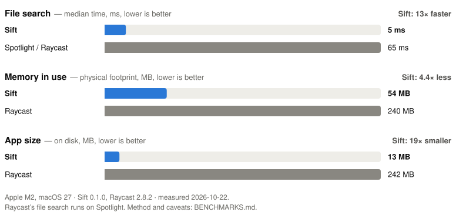

# Sift

A Rust-native macOS launcher and file search engine: Raycast's keyboard-first
launcher combined with Everything-style instant filename search, built for low
memory use and near-zero idle CPU.

Option+Space opens a panel that finds applications, files and folders as
you type, with a calculator, snippets, custom commands and an optional
clipboard history. The file index updates itself as files change. There is
also a command-line indexer and search tool, `sift`.

**Status:** [0.2.2](https://github.com/kylianmarceau/sift/releases/tag/v0.2.2),
an early release. See [PLAN.md](PLAN.md) for the roadmap and
[CHANGELOG.md](CHANGELOG.md) for what is in each release.

## Performance

<picture>
  <source media="(prefers-color-scheme: dark)" srcset="docs/benchmarks-dark.svg">
  
</picture>

Measured side by side on an Apple M2. File search times are for five
queries over a 54,000-file `~/Documents`, against `mdfind`, the Spotlight
search that Raycast's file search is built on. See
[BENCHMARKS.md](BENCHMARKS.md) for the method and caveats.

## Install

Sift needs **macOS 13 (Ventura) or later on an Apple Silicon Mac**.

**With Homebrew:**

```bash
brew install --cask kylianmarceau/sift/sift
```

`brew upgrade` then keeps it up to date. Open Sift from Applications and
see step 3 below.

To upgrade an existing Homebrew installation:

```bash
brew update
brew upgrade --cask kylianmarceau/sift/sift
```

Homebrew also installs the `sift` CLI from the app bundle. Native window
controls are experimental and opt-in. In 0.2.1, enabling Window Shortcuts and
Controls leaves windows where you put them. Automatic Tiling is a separate
switch, off by default. Persistent app/title shortcuts can focus or launch
a target app; see the [setup and controls](docs/window-manager.md).

**Or by hand:**

1. Download `Sift-VERSION-arm64.dmg` (or the `.zip`) from the
   [latest release](https://github.com/kylianmarceau/sift/releases/latest).
2. Open the disk image and drag **Sift** into **Applications**.
3. Open Sift from Applications. The search panel appears once at launch;
   after that, **Option+Space** shows and hides it. To use another
   shortcut, open Sift Settings › General › Keyboard Shortcut, click the
   keys shown and press the new shortcut.

**If macOS says Sift "cannot be opened" or "cannot be verified":** a
release is notarized by Apple only when it was signed with a Developer ID
(the release notes say which). For a build that is not, open
**System Settings › Privacy & Security**, scroll to the message about
Sift, and click **Open Anyway**. macOS remembers the choice.

To check a download, compare it with the release's `SHA256SUMS`:

```bash
shasum -a 256 -c SHA256SUMS --ignore-missing
```

**Permissions.** Launching and file search need no Accessibility or Full
Disk Access. macOS asks once when you add Documents, Desktop or Downloads.
The optional native window manager requires Device Control and Data Access
on macOS 27, or Accessibility on older macOS, when enabled; it is off by default.
Grant that permission to **Sift** itself. Sift has no Dock icon.

**Open at Login** is off until you turn it on in Sift Settings › General.
Sift then appears in System Settings › General › Login Items, where you
can also remove it.

### Updates and privacy

Sift keeps everything on your Mac: the index, recents, favorites,
clipboard history and logs. It sends no telemetry.

The one network request it makes is the update check. At most once a day,
when the panel opens, Sift asks GitHub for the version number of the
latest release (one HTTPS request to `api.github.com`, which sees your IP
address and the user agent `Sift/VERSION`). If a newer version exists, the
panel footer says so; *Check for Updates* in the launcher, or the button
in Settings, opens the release page. Sift never downloads or installs
anything itself: you update by installing the new version the same way.

To turn the check off, switch off *Check Automatically* in Settings ›
General, or search for *Edit Sift Configuration* and set:

```toml
[updates]
check = false
```

*Check for Updates* still works on request while the automatic check is
off.

### Uninstall

With Homebrew: `brew uninstall --cask sift` (add `--zap` to remove your
data too, except `~/.config/sift`). Otherwise:

1. Turn off Open at Login in Sift Settings, if you turned it on.
2. Open the panel and press **Cmd-Q** to quit, then delete
   `/Applications/Sift.app`.
3. To remove your data too, delete `~/Library/Application Support/sift`
   (index, settings, recents, favorites, clipboard history),
   `~/Library/Logs/Sift`, and `~/.config/sift` if you put your config there.

## Using Sift

- Type to search apps, files and folders (files need two characters).
  With nothing typed, the panel lists your favorites and recent items.
- **↑/↓** (or Ctrl-P/Ctrl-N) to move.
- **Enter** to open (or copy, for calculator results, snippets and
  clipboard entries).
- **⌘Enter** to show the selection in Finder.
- **⌘Y** to preview the selected file with Quick Look (arrows keep
  working; Esc closes the preview).
- **⌘D** to add or remove a favorite (★). **Ctrl-X** removes an item
  from the recent list.
- **Esc** or clicking elsewhere to close.
- **Cmd-Q** while the panel is open quits Sift.

**Calculator:** type an expression such as `12.5 * 4`, `2^10 - 1` or
`sqrt(2)`. The value is the top result, and Enter copies it.

**File filters** narrow file results:

| filter | example |
|--------|---------|
| extension | `report ext:pdf`, `ext:jpg,png` |
| type | `type:image`, `type:video`, `type:audio`, `type:document`, `type:code`, `type:archive`, `type:folder`, `type:file` |
| folder | `notes in:projects`, `in:~/Documents` |
| size | `size:>10mb`, `size:<500k` |
| date | `modified:<7d`, `modified:>1y` (`min`, `h`, `d`, `w`, `mo`, `y`) |

**Snippets and custom commands:** search for *Edit Sift Configuration*.
It creates `~/Library/Application Support/sift/config.toml` with
commented examples. If you keep your dotfiles in the XDG layout, put the
file at `~/.config/sift/config.toml` (or `$XDG_CONFIG_HOME/sift/config.toml`)
instead: Sift uses that one when it exists. Snippets are found by name or keyword, and Enter
copies their text (`{date}`, `{time}` and `{datetime}` are filled in).
Custom commands open a URL, open a file or app, or run a shell command.
Changes apply the next time the panel opens.

**Clipboard history** is off by default. Turn it on in Sift Settings ›
Clipboard History (or set `enabled = true` under `[clipboard]` in the
config), then type `clip` (or `clip invoice`) to search what you copied.
**⌘D** pins the selected entry (★): pinned entries are listed first and
kept until you unpin them. **Ctrl-X** deletes the selected entry. Each
entry shows the app it was copied in; `clip from:slack` lists only what
you copied in Slack. Settings also chooses how many other entries
to keep. Text that password managers mark as concealed is never kept.
*Clear History* in Settings, or the *Clear Clipboard History* command,
deletes everything kept except pinned entries.

Sift follows the system's light or dark appearance and your accent colour
(System Settings › Appearance).

**VoiceOver:** while VoiceOver runs, Sift speaks the highlighted result
when it moves ("report.pdf, file, in Documents, 2 of 8"). It also speaks
the number of results and the top one when typing pauses, and any message
shown. **Increase Contrast** and **Differentiate Without Color** (System
Settings › Accessibility › Display) give stronger colours and an outlined
selection. Both are picked up the next time the panel opens.

**If something goes wrong:** Sift keeps a log at
`~/Library/Logs/Sift/sift.log`, including crash reports. Nothing leaves
your Mac. If Sift did not quit normally, it checks the file index at the
next start. A damaged index is moved aside (into a `damaged-…` folder
next to it) and rebuilt from the saved folder list. A damaged `state.db`
is renamed to `state.db.damaged-…`, and recents and favorites start
again.

**Choosing folders:** search for *Sift Settings* (or "preferences") and
press Enter. Add the folders you want searchable. The General section at
the top holds the keyboard shortcut, Open at Login, the update check and
a button that opens `config.toml`. Clipboard History has its own section.
Options changed in Settings are written to `config.toml`, keeping
everything else in the file; a file with a mistake in it is not changed.

**Changing the shortcut:** in Settings › General, click the shortcut and
press the new one (Esc cancels). It needs ⌘, ⌃ or ⌥, or can be a
function key on its own. It works by key position, so it stays the same
if you switch keyboard layouts. macOS does not tell Sift when another app
uses the same shortcut, so if the panel stops appearing, pick another
one. *Use ⌥Space* restores the default. macOS asks once for
access to Documents, Desktop or Downloads. Folders indexed with
`sift index` in a terminal show up there too; they share one index.

Environment options: `SIFT_INDEX_DIR` (index location),
`SIFT_CONFIG_DIR` (where `config.toml` and `state.db` live; it takes
priority over `XDG_CONFIG_HOME`),
`SIFT_START_HIDDEN=1` (don't show the panel at launch), `SIFT_LOG=debug`,
`SIFT_LOG_DIR` (log location), `SIFT_ANNOUNCE=1` (make the VoiceOver
announcements, logged at debug level, even when VoiceOver is off), and
`SIFT_RUN_COMMAND=<id>` (run a built-in command such as `settings` half a
second after launch, as choosing it does; for testing), and
`SIFT_UPDATE_URL` (where the update check looks; also accepts a `file://`
URL, for testing).

## Building from source

On the `native-window-manager` branch, Settings also offers
manual window shortcuts, persistent app/title targets, and optional tiling and
workspaces. Open windows are searchable with `win`; `ws` searches workspaces
when Automatic Tiling is enabled. See [Window Management](docs/window-manager.md) for setup,
shortcuts, configuration, CLI commands, and validation status. It requires no
AeroSpace installation. Window controls remain experimental and off
by default while broader application and multi-monitor acceptance continues.

Requirements:

- An Apple Silicon Mac with macOS 13 or later
- Rust 1.85 or newer (`rustup` stable)
- Xcode Command Line Tools (for the bundled SQLite C build). Full Xcode
  is not needed: the launcher compiles its Metal shaders at runtime.

```bash
scripts/bundle-app.sh            # builds target/release/Sift.app
open target/release/Sift.app
```

`scripts/bundle-app.sh --install` also copies the app to `~/Applications`.
The bundle is ad-hoc signed, which is enough to run it on the Mac that
built it. The first launch after a build takes about a second, while GPUI
compiles its shaders.

To see timing logs (startup, catalog load, hotkey-to-first-frame), run the
executable from a terminal instead:

```bash
target/release/Sift.app/Contents/MacOS/Sift
```

## The `sift` command-line tool

Built from source (see above). It reads and writes the same index as the
app, so folders indexed here show up in Sift Settings too.

```bash
# Index one or more folders (the index lives in
# ~/Library/Application Support/sift/dev-index unless --index-dir is given)
cargo run --release -- index ~/Documents

# Search
cargo run --release -- search project
cargo run --release -- search "annual report" --limit 10
cargo run --release -- search report --ext pdf --files
cargo run --release -- search prjrs --stats      # fuzzy, with timing

# Inspect or drop roots
cargo run --release -- status
cargo run --release -- remove ~/Documents

# Check the index: SQLite integrity, internal consistency, and a fresh
# scan compared with what is indexed (--quick skips the scan)
cargo run --release -- verify
```

Useful index options: `--exclude <path>`, `--exclude-name node_modules`,
`--descend-packages`, `--cross-devices`, `--include-sensitive`, `--include-dependencies`. Dependency and cache folders (`node_modules`, `.git`, `.venv`, …) are skipped by default, and the options are remembered per root: `sift index` with no paths re-indexes every root the same way. `~/Library`
and `~/.Trash` are skipped by default, and indexing `/` or your whole home
folder requires `--allow-broad-root`.

## Development

```bash
cargo fmt --all -- --check
cargo clippy --workspace --all-targets -- -D warnings
cargo test --workspace
scripts/bench.sh            # reproducible benchmarks, see BENCHMARKS.md
scripts/ui-bench.sh 5       # types through the launcher, then memory and idle CPU
cargo run --release -p sift-apps --example bench_apps   # app search timing
cargo run --release -p sift-files --example live_latency # change-to-searchable timing

# Longer live-update fuzzing (the test suite runs 400 operations)
SIFT_FUZZ_SEED=7 SIFT_FUZZ_OPS=3000 cargo test --release -p sift-files --test service random_edits
```

`scripts/ui-bench.sh` needs the 100k-file tree from `scripts/bench.sh`. It
opens the panel on screen while it types, using its own config, index and
log directories. To compare two builds, keep a copy of the older
`target/release/sift-launcher` and run it with
`LAUNCHER=/path/to/copy scripts/ui-bench.sh 5`.

Release builds: `scripts/release.sh` (see [RELEASING.md](RELEASING.md)).
The app icon is drawn in `packaging/icon.svg`; `scripts/make-icon.sh`
renders it into `packaging/Sift.icns`.

Design notes are in [ARCHITECTURE.md](ARCHITECTURE.md), the roadmap is in
[PLAN.md](PLAN.md), and measurements are in [BENCHMARKS.md](BENCHMARKS.md).
To contribute, see [CONTRIBUTING.md](CONTRIBUTING.md); to report a security
problem, see [SECURITY.md](SECURITY.md).

## License

MIT; see [LICENSE](LICENSE). The app bundle includes the licences of the
Rust crates it is built from (`Contents/Resources/THIRD_PARTY_LICENSES.txt`).
